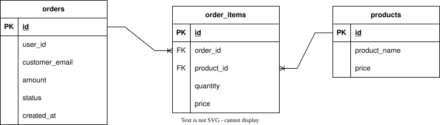
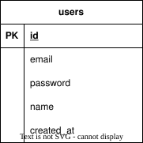
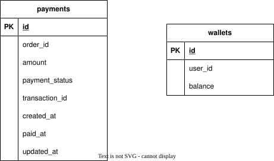

Микросервисный интернет-магазин на Spring Boot + Kafka + JWT.

**Рабочий процесс**
1. Пользователь регистрируется -> получает JWT токен
2. Пользователь создает заказ -> OrderService → Kafka
3. PaymentService получает событие -> обрабатывает платеж
4. NotificationService получает событие -> отправляет email

# Сервисы и порты
| Сервис               | Порт | Что делает                                      |
|----------------------|------|-------------------------------------------------|
| User Service         | 8080 | Регистрация, логин, JWT токены, веб-страницы    |
| Order Service        | 8081 | Создание и просмотр заказов                     |
| Payment Service      | 8082 | Обработка платежей                              |
| Notification Service | 8083 | Отправка email уведомлений                      |
| PostgreSQL           |  -   | Каждый сервис имеет свою БД                     |
| Kafka                | 9092 | Обмен событиями между сервисами                 |

## Базы данных

Каждый сервис имеет свою собственную PostgreSQL БД:

| Сервис               | Host                     | Порт | Database            |
|----------------------|--------------------------|------|---------------------|
| User Service         | postgres-user            | 5432 | userdb              |
| Order Service        | postgres-order           | 5433 | orderdb             |
| Payment Service      | postgres-payment         | 5434 | paymentdb           |
| Notification Service | postgres-notification    | 5435 | notificationdb      |

Для контроля изменений и чистой истории изспользуется Flyway.

### Схема БД
**Order Service**

**User Service**

**Payment Service**

## Мониторинг и нагрузочное тестирование

Проект покрыт системой мониторинга на базе **Spring Boot Actuator + Micrometer + Prometheus + Grafana**. Настроены инфраструктурные и бизнес метрики.

**Стек мониторинга**
* **Spring Boot Actuator** - сбор метрик из коробки
* **Micrometer** - API для сбора и экспорта метрик в различные системы мониторинга
* **Prometheus** - база данных временных рядов (TSDB)
* **Grafana** - визуализация и дашборды
* **k6** - инструмент для нагрузочного тестирования

### Какие метрики собираются

В проекте реализован сбор трех уровней метрик, что позволяет отслеживать состояние системы от железа до бизнес-логики:

**1. Инфраструктурные (из коробки):**
*   **HTTP-метрики:** время ответа (p95, p99), количество запросов, коды ответов (`http_server_requests_seconds`).
*   **JVM:** использование Heap/Non-Heap памяти, работа сборщика мусора (GC), количество потоков, загрузка CPU.
*   **Пул соединений (HikariCP):** активные и свободные соединения с БД, время ожидания.
*   **Kafka:** количество необработанных сообщений в очереди. Показывает успевает ли консьюмер вычитывать данные со скоростью их поступления от продюсера и не накапливается ли в топике критический объем данных.

**2. Бизнес-метрики (кастомные):**
Для отслеживания состояния заказов и оплат реализованы кастомные счетчики через `MeterRegistry`:
*   `order_create_attempt_total` / `order_create_success_total` — сколько заказов пытались создать и сколько успешно создано.
*   `order_error_total{reason="..."}` — количество ошибок с разбивкой по причине (например, товар не найден).
*   `payment_processing_time_seconds` — время, за которое `payment-service` обрабатывает платеж (от получения события до ответа).
*   `orders_pending_payment_count` (Gauge) — количество заказов, «зависших» в ожидании оплаты (помогает отслеживать лаг в Kafka).

**3. Кеширование (Redis / Hot-Cache):**
Реализован кастомный алгоритм "горячего кеша" (если товар запрашивают чаще N раз за 5 минут, он кешируется на 15 минут). Для оценки эффективности кеша добавлены метрики:
*   `order_cache_hit_total` / `order_cache_miss_total` — количество попаданий и промахов. Соотношение позволяет понять, насколько эффективно настроен порог кеширования.

**Технологии**
  * Java 21
  * Spring Boot 4.3
  * Spring Security + JWT
  * PostgreSQL + Flyway (миграции)
  * Apache Kafka (ассинхронный обмен событиями)
  * Redis (Hot-cache для товаров)
  * Micrometer + Prometheus + Grafana (мониторинг и визуализация)
  * k6 (нагрузочное тестирование)
  * Docker / Docker Compose
